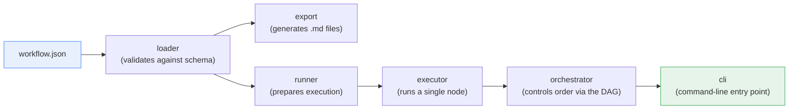
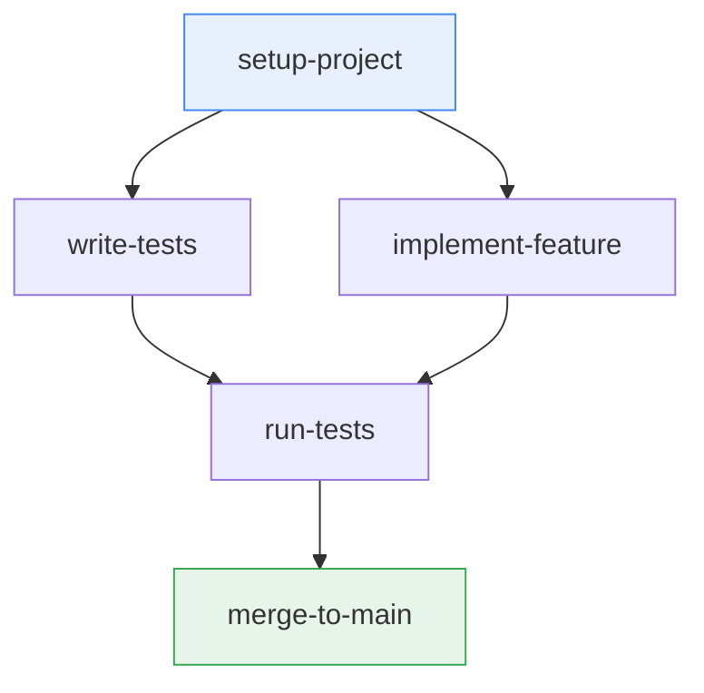
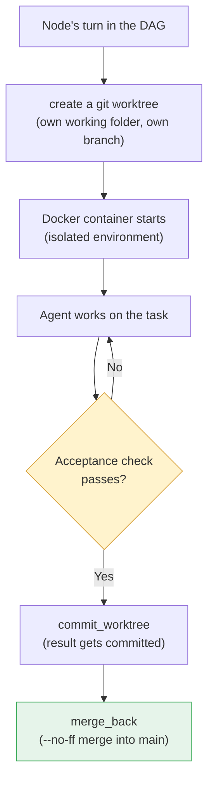

# agentic-workflows

A visual tool for building and annotating dev workflows, which are then executed step by step by Claude Code (or compatible agents).

## The idea in one sentence

Draw a workflow as a DAG → fill in structured slots per node (goal, inputs, constraints, acceptance, comments) → the tool generates slash commands / sub-agent definitions for Claude Code from it.

**Quick primer, in case these terms are new:** A **DAG** ("Directed Acyclic Graph") is just a flowchart with arrows that never loop back — e.g. "Setup" → "Write tests" → "Build feature" → "Run tests". Each box in that diagram is called a **node** here, each arrow an **edge**. The tool lets you draw such a graph visually and then turns it into files an AI coding agent (currently Claude Code) can work through on its own.

## Why this exists (the problem being solved)

When you ask an AI agent to "build feature X", you often get usable but *unverified* code back — the agent *claims* it works, but nobody has actually checked. On multi-step tasks (first a database migration, then business logic, then tests, then deploy), this gets messy and risky fast.

The idea here: write the workflow down explicitly as a graph, and attach an **automatically checkable definition of done** to every step (e.g. "pytest must pass", "this curl call must return status 200"). Only once that check passes does the step count as complete and the next one is allowed to start. That turns "the agent claims it's done" into "the system verified it."

## Architecture

The project has two parts that work together: the **engine** (Python, does the actual work) and the **canvas UI** (a single HTML file for visually building workflows).

### 1. The processing pipeline

A workflow always passes through the same stations before it runs:



- **loader** — reads the JSON file and validates it against a fixed schema (more on that below). If it finds errors, it collects *all* of them at once instead of stopping at the first — saves a lot of debugging pain.
- **export** — the "stage 1" path: the graph is turned into ready-made Claude Code files (slash commands, sub-agents) that a human then triggers manually.
- **runner / executor / orchestrator** — the "stage 2" path: the engine executes the graph *itself*, node by node, in the correct order (the `orchestrator` knows the DAG and tracks what's waiting on what).
- **cli** — the actual command you type, e.g. `agentic-workflows run workflow.json --sandbox`.

### 2. A workflow is a graph

Here's what an example graph looks like (arrows = "must be done first"):



`write-tests` and `implement-feature` can run in parallel (both only depend on `setup-project`), but `run-tests` only starts once *both* are done. That's the point of a DAG: it makes dependencies and parallelizability explicit instead of hiding them in a to-do list.

### 3. How a single node gets executed (stage 2 / sandbox)

So that an autonomously running agent can't accidentally break the main project, every node runs in isolation:



Two terms worth explaining here:

- **Docker container** — a lightweight, isolated "mini-environment" the agent works in. If something goes wrong, it's contained there and doesn't damage the rest of the machine.
- **git worktree** — a second, parallel working folder of the same git repo, on its own branch. This lets a node work on its own branch without multiple concurrently running nodes overwriting each other's files. Only after the check passes does the result get merged (`--no-ff`, i.e. with a visible merge commit instead of a clean "fast-forward") back into `main`.

Along the way, each run's cost is tracked (`total_cost_usd`), and the result lands in a small SQLite database (`.aw-runs/runs.sqlite3`) — so a history is kept even though the workflow definition itself (the JSON file) stays unchanged in the git repo.

### 4. Two maturity levels that coexist

| | Stage 1 | Stage 2 |
|---|---|---|
| Who orchestrates? | A human, in the canvas | A master agent, autonomously |
| Output | `.md` files to trigger manually | A directly executed run with log + cost |
| Use case | Designing workflows, testing individual nodes | Standard operation for larger workflows |
| CLI | `... export workflow.json` | `... run workflow.json --sandbox` |

Both are fully implemented; stage 2 is now the primary mode, stage 1 remains as a design/debug tool.

## Data model

A workflow is a JSON file validated against `schema/workflow.schema.json` (**JSON Schema** is a standard for specifying which fields a JSON file must/may have — like a form with required fields). Validation collects all violations at once instead of stopping at the first error.

At the top level, a workflow has `version`, `name`, optionally `description`, optionally `defaults`, plus the two core fields `nodes[]` and `edges[]`.

A **node** is a verifiably completable task:

| Field | Required? | Meaning |
|---|---|---|
| `id` | yes | kebab-case name, also used as the export filename |
| `goal` | yes | becomes the basis of the prompt the agent receives |
| `acceptance` | yes | at least one check (see below) |
| `title`, `inputs[]`, `constraints[]`, `comments` | optional | extra context for the agent |
| `model` | optional | `planner` \| `sonnet` \| `local` — controls which model (and thus what cost) is used for this node |
| `kind` | optional | `command` \| `agent` — determines the export format |

An **edge** is a directed dependency with `from` and `to` (both node IDs) and an optional `label`: `from` must be done before `to` starts. The edges are what span the DAG (see diagram above).

### Acceptance check — the most important building block

The `acceptance` block is what makes autonomous execution safe in the first place: a node only counts as done once **all** of its checks pass. A check is a shell command plus an expected result — essentially an automatic verifier that looks after every step instead of taking the agent's word for it.

- `command` — the command to run (deterministic, no side effects outside the repo)
- `expect` — what must hold true; multiple conditions are AND-combined: `exitCode`, `stdoutMatches`, `stdoutNotMatches`, `stderrMatches` (regular expressions)
- optional: `description`, `cwd`, `timeoutSeconds` (default 120)

Rule of thumb: a small node has one check, a large node has several.

### Minimal example

```json
{
  "version": "1",
  "name": "Smoke-Test-Workflow",
  "nodes": [
    {
      "id": "run-tests",
      "goal": "Run the test suite and make sure it's green.",
      "acceptance": [
        {
          "description": "All tests pass",
          "command": "pytest -q",
          "expect": { "exitCode": 0 }
        }
      ]
    }
  ],
  "edges": []
}
```

A more complete example with model routing, multiple checks, and DAG edges lives in `examples/example-workflow.json`.

## Export targets

Depending on `kind`, the `export` step produces different files:

- `.claude/commands/<node-id>.md` — slash commands, one file per node
- `.claude/agents/<node-id>.md` — sub-agent definitions
- `WORKFLOW.md` — a Mermaid diagram of the graph plus all prompts inline, as a readable single-file overview

## Status

The engine and CLI are fully implemented and tested (loader → export → runner → executor → orchestrator → cli), including end-to-end verification on a real server (sandbox backend: Docker + git worktree per node, including cost tracking and merge flow). The UI (`ui/canvas.html`) is a single HTML file with no external dependencies.

A separate project (`job-search-system`) already consumes this engine as a dependency — proof that this is a generic tool rather than a one-off solution to a single problem.

## Glossary (quick reference)

- **DAG** — Directed Acyclic Graph: a flowchart with no loops back. Defines what waits on what.
- **JSON Schema** — a rulebook defining which fields a JSON file must/may have.
- **Node** — a single step/task in the workflow graph.
- **Edge** — a dependency between two nodes ("A must finish before B").
- **Acceptance check** — an automatically runnable command that verifies a node is actually done.
- **Sandbox** — an isolated environment (here: Docker container + its own git branch) where an agent can work safely.
- **git worktree** — an additional, parallel working folder of the same repo, on its own branch.
- **`--no-ff` merge** — a git merge that always creates a visible merge commit instead of cleanly "fast-forwarding" history. Useful for seeing which changes belong together as a block in the log.
